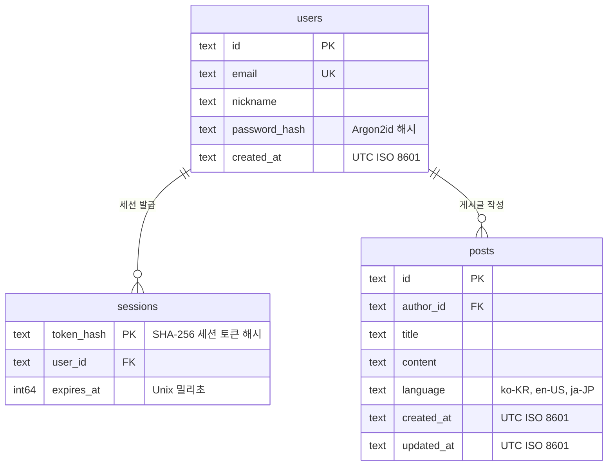
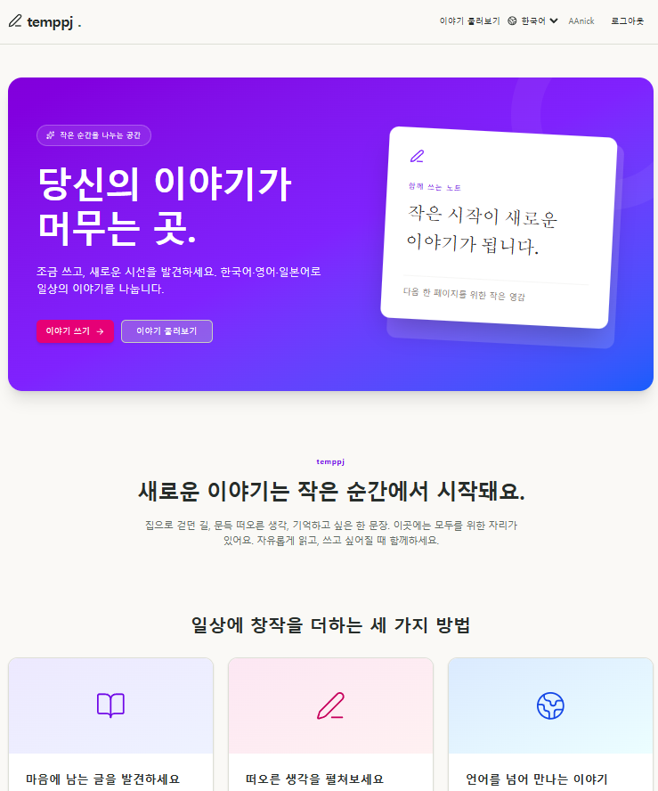
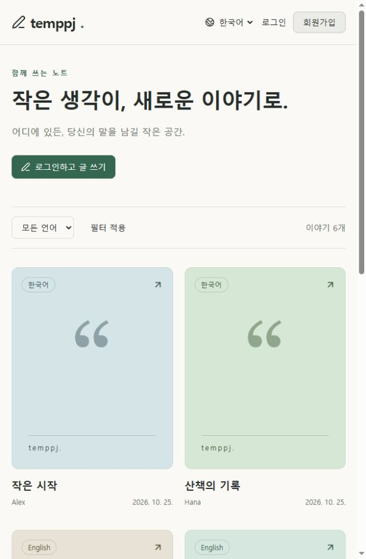

# temppj

한·영·일 다국어 게시판과 회원 전용 실시간 채팅을 제공하는 풀스택 프로젝트입니다. React Router 화면은 Elysia와 FastAPI 중 하나를 백엔드로 사용합니다.

## 주요 기능

### `react_router`

- React Router SSR의 loader와 action으로 조회·폼 제출을 처리하고, 브라우저와 백엔드 사이에서 인증 쿠키를 중계합니다.
- 화면 언어와 글 언어 필터를 독립적으로 선택할 수 있습니다. 목록은 최신순으로 12개씩 표시하며, URL 기반 상세 Drawer를 닫아도 필터와 페이지를 유지합니다.
- API 연결에 실패하면 작성·수정 초안을 보존합니다. 채팅도 발행 확인 전까지 입력을 유지하며, 연결 복구 후 다시 연결할 수 있습니다.

### `elysia`

- Argon2id로 비밀번호를 해시하고, 세션 토큰은 해시만 DB에 저장합니다. 7일 만료 세션 쿠키와 Origin 검사로 변경 요청을 보호하고, 글 수정·삭제는 작성자에게만 허용합니다.
- Drizzle과 SQLite로 사용자·세션·게시글을 저장하고, 시작 시 스키마 마이그레이션을 적용합니다.
- Valkey에 언어·페이지별 게시글 목록을 120초간 캐시합니다. 글 변경이나 외부 DB 쓰기를 감지하면 새 캐시 키를 사용하고, Valkey 장애 시 SQLite로 대체 조회합니다.
- WebSocket과 Valkey Pub/Sub으로 공용 채팅 메시지를 전달합니다. 연결과 메시지 송수신 시 세션을 확인해 로그아웃하거나 만료된 연결을 종료합니다.

### `fastapi`

- Elysia의 인증·게시글·채팅을 Python으로 이식하고, 같은 HTTP·WebSocket 계약으로 React Router와 연동합니다.
- SQLModel과 Alembic으로 독립 SQLite DB를 관리합니다. 설치·실행·테스트는 Python 3.13과 `uv`로 수행합니다.

## ERD

Elysia와 FastAPI는 각각의 SQLite DB에 아래 구조로 데이터를 저장합니다. 사용자 한 명은 여러 세션과 게시글을 가질 수 있으며, 각 세션과 게시글은 한 사용자에 속합니다.



- 모든 컬럼은 `NOT NULL`입니다. `PK`는 기본키, `FK`는 외래키, `UK`는 고유키를 뜻합니다. 이메일은 고유 인덱스로 중복을 방지합니다.
- `sessions.user_id`와 `posts.author_id`는 `users.id`를 참조합니다. 사용자 삭제 시 연결된 세션과 게시글도 `ON DELETE CASCADE`로 삭제됩니다.
- 게시글 언어는 `CHECK` 제약조건으로 제한합니다. 세션의 사용자별 조회, 게시글의 최신순·언어별 조회에 인덱스를 사용합니다.
- 세션 만료 시각은 두 백엔드 모두 밀리초 단위 정수로 저장하며, 선언 타입은 Elysia에서 `INTEGER`, FastAPI에서 `BIGINT`입니다.

스키마 정의는 [Elysia 모델](elysia/src/schema.ts)과 [FastAPI 모델](fastapi/src/temppj_api/models.py)에서 확인할 수 있습니다.

## 로컬 실행

프런트엔드는 `http://localhost:3000`, 기본 백엔드 상태 확인 주소는 `http://127.0.0.1:3001/api/health`입니다. 기본 포트 3001에서는 백엔드 하나만 실행합니다.

### Elysia 기본 실행

Node.js 22 이상과 Bun 1.3.14 이상이 필요합니다. 루트에서 실행합니다.

```sh
bun install
bun run setup
bun run dev
```

### FastAPI 선택 실행

Python 3.13과 `uv`가 필요합니다. 루트에서 다음 명령을 실행합니다.

```sh
cd fastapi
uv sync --locked
uv run --locked python -m temppj_api.setup
uv run --locked python -m temppj_api --reload
```

프런트엔드는 별도 터미널의 루트에서 `bun install` 후 `bun run --cwd react_router dev`로 실행합니다. 백엔드 주소를 변경했다면 프런트엔드 실행 환경의 `API_URL`도 맞춥니다.

### 데모 데이터

각 백엔드의 setup은 데모 계정 2개와 게시글 206개를 준비합니다. 다시 실행해도 기존 데이터를 덮어쓰지 않으며, 삭제한 샘플 글은 다시 생성됩니다.

| 이메일 | 비밀번호 | 닉네임 |
| --- | --- | --- |
| demo1@example.com | `DemoPass123!` | Alex |
| demo2@example.com | `DemoPass123!` | Hana |

기본 DB는 각각 `elysia/db/board.sqlite`, `fastapi/db/board.sqlite`입니다. 두 DB는 계정·글·세션을 별도로 관리하므로 백엔드를 전환하면 다시 로그인합니다.

## 설정과 공통 API

루트의 [.env.example](.env.example)을 참고해 `.env`를 설정합니다. FastAPI는 루트 `.env`를 읽고 프로세스 환경변수를 우선합니다.

| 변수 | 기본값 | 용도 |
| --- | --- | --- |
| `APP_ORIGIN` | `http://localhost:3000` | 프런트엔드 출처 |
| `API_URL` | `http://127.0.0.1:3001` | 프런트엔드에서 연결할 백엔드 주소 |
| `API_PORT` | `3001` | 백엔드 포트 |
| `DATABASE_PATH` | `db/board.sqlite` | 각 백엔드 디렉터리 기준 SQLite 경로 |
| `VALKEY_URL` | 미설정 | 목록 캐시와 실시간 채팅에 사용할 Valkey 주소 |

| 메서드 | 경로 | 기능 |
| --- | --- | --- |
| GET | `/api/health` | 서버와 DB 상태 확인 |
| POST | `/api/auth/signup`, `/api/auth/signin`, `/api/auth/signout` | 가입, 로그인, 로그아웃 |
| GET | `/api/auth/me` | 현재 사용자 조회 |
| GET, POST | `/api/posts` | 목록 조회와 작성. 목록은 `language`와 `page`를 지원 |
| GET, PATCH, DELETE | `/api/posts/:id` | 상세 조회, 수정, 삭제 |
| WebSocket | `/api/chat` | 회원 전용 공용 채팅 |

변경 API를 직접 호출할 때는 `APP_ORIGIN`과 일치하는 `Origin` 헤더를 전달합니다. 브라우저의 채팅 소켓은 백엔드에 직접 연결합니다. 채팅에는 실행 중인 Valkey가 필요하며, 같은 Valkey의 `temppj:chat:public:v1` 채널에 연결된 백엔드는 채팅방을 공유합니다. 서버는 채팅 이력을 저장하지 않으며, 현재 채팅 페이지는 받은 메시지를 최근 100개까지 표시합니다.

## 검증

루트에서 Elysia·React Router를 확인합니다. `bun run test`는 프로덕션 빌드와 SSR 폼·권한·장애 처리 검사를 포함합니다.

```sh
bun run test
bun run typecheck
bun run build
bun run lint .
```

FastAPI는 `fastapi/`에서 검사합니다.

```sh
uv run --locked pytest
uv run --locked ruff check .
uv run --locked ruff format --check .
```

`VALKEY_URL`을 설정하면 실제 Valkey로 캐시 만료·무효화, 채팅 전달, 세션 폐기와 재연결을 검증합니다.

## 화면



