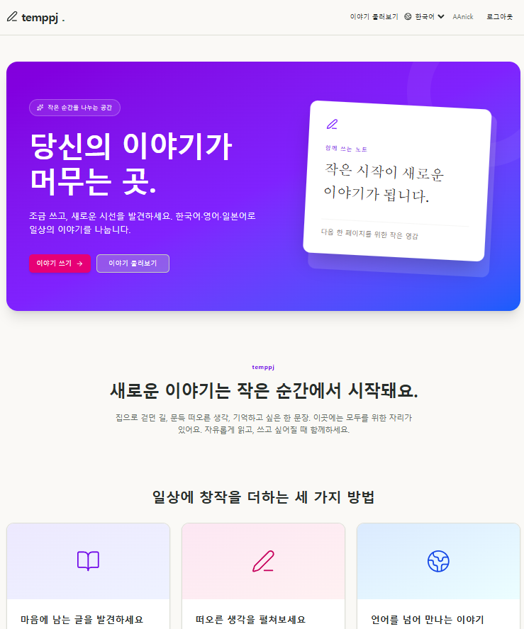
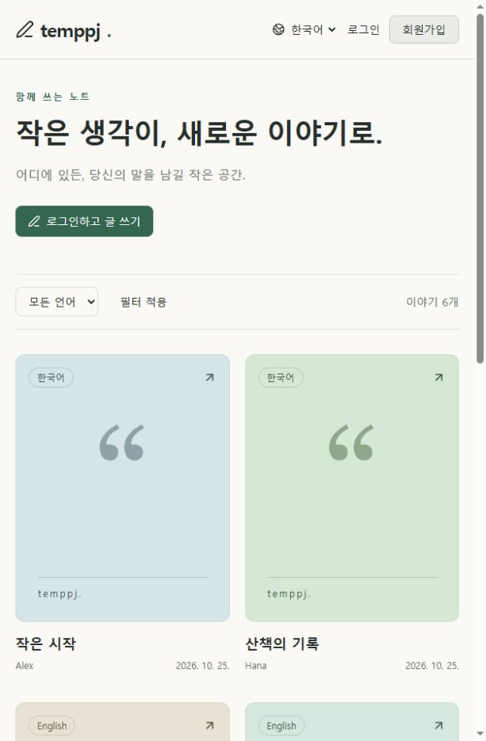

# temppj

React Router SSR과 Elysia로 만든 다국어 게시판입니다. 기존 poem 화면의 카드와 Drawer를 바탕으로 회원 인증과 실제 DB 저장을 연결했습니다.

## 실행

Node.js **22 이상**, Bun **1.3.14 이상**이 필요합니다. Windows PowerShell에서도 같은 명령을 사용합니다.

```bash
bun install
# .env.example을 .env로 복사하면 VALKEY_URL을 사용한 캐시가 활성화됩니다.
bun run setup
bun run dev
```

- Frontend: http://localhost:3000
- Backend 상태 확인: http://localhost:3001/api/health
- `dev`는 별도 실행 파일 없이 Bun의 workspace 병렬 실행 기능을 사용합니다. 종료는 `Ctrl+C`입니다.

회원가입에는 외부 서비스나 이메일 인증이 필요하지 않습니다. 아래 계정으로도 바로 시연할 수 있습니다.

| 이메일            | 비밀번호     | 닉네임 |
| ----------------- | ------------ | ------ |
| demo1@example.com | DemoPass123! | Alex   |
| demo2@example.com | DemoPass123! | Hana   |

`setup`은 스키마 마이그레이션과 3개 언어의 샘플 게시글 206개(기존 6개 + 페이지네이션 시연용 200개)를 준비합니다. 샘플만 있을 때 12개씩 총 18페이지입니다. 반복 실행해도 기존 계정·글을 덮어쓰지 않습니다. 명시적으로 삭제한 샘플 글은 다시 생성됩니다. 일반 글은 변경하지 않습니다.

## 기능과 시연

1. `/`의 랜딩 페이지에서 `/poem` 게시판으로 이동하고, 카드를 눌러 Drawer에서 본문을 읽습니다.
2. 화면 언어를 한국어·영어·일본어로 바꾸고 별도로 글 언어 필터를 선택합니다.
3. 회원가입 또는 로그인 후 글을 작성합니다. 제목 1~100자, 본문 1~10,000자를 지원합니다.
4. 작성한 글의 Drawer에서 수정·삭제합니다. 다른 계정으로 로그인하면 편집 버튼이 표시되지 않고, 직접 API를 호출해도 거부됩니다.
5. 상세 URL을 새로고침하거나 뒤로가기를 사용한 뒤 로그아웃합니다.

글자 수는 Unicode 코드 포인트 수로 계산합니다. 글은 모두 공개되며 일반 텍스트와 줄바꿈을 보존합니다. 자동 번역·댓글·좋아요·이미지 업로드·프로필·결제는 구현 범위에서 제외했습니다.

## 구조

```text
Browser → React Router loader/action → Elysia → Valkey (목록 캐시)
                                             → Drizzle → SQLite (원본)

react_router/   SSR 페이지, 폼 action, 카드/Drawer, 번역 TOML
elysia/         API, 인증, DB 스키마·마이그레이션·샘플 데이터
shared/         공개 DTO, 언어·입력 검증
react_router/tests/  단위 테스트, HTTP CRUD 및 SSR 장애 검사 (*.test.ts)
logs/          Backend/Frontend의 일별 로그 (Git 제외)
```

Frontend는 React Router **7.18.0**, React 19, Tailwind 4와 기존 shadcn/Vaul 컴포넌트를 사용합니다. `@react-router/fs-routes`가 `app/routes/`의 파일명으로 라우트를 구성합니다. 예를 들어 `poem.$id.edit.tsx`는 `/poem/:id/edit`, `api.cookie.lang.ts`는 `/api/cookie/lang`, `$.tsx`는 나머지 경로를 처리합니다. Backend는 Elysia 1.3과 Bun SQLite를 사용합니다. 재현 가능한 의존성 버전은 루트 `bun.lock`으로 고정합니다.

- Elysia가 무작위 256비트 세션을 발급하고 DB에는 토큰 해시만 저장합니다. 쿠키는 HttpOnly·SameSite=Lax이며 7일 후 만료됩니다. HTTPS Origin에서는 Secure도 설정됩니다.
- 비밀번호는 Argon2id로 해시합니다. 이메일은 정규화하고, 글 작성자 ID는 클라이언트 입력과 관계없이 세션에서 결정합니다.
- React Router는 인증 쿠키와 Set-Cookie를 중계합니다. 별도 Frontend 인증 저장소나 localStorage 토큰을 두지 않습니다. 두 서버 모두 변경 요청의 Origin을 검사합니다.
- UI 언어는 선택 쿠키 → 브라우저 언어 → 영어 순으로 정합니다. 글 언어는 독립적이며, 번역 리소스는 빌드에 포함됩니다. 날짜는 UTC 기준으로 언어에 맞춰 표시합니다.
- 목록은 최신순 12개씩 표시합니다. 상세 주소는 `/poem?post=<id>`이고 닫을 때 목록 필터와 페이지를 유지합니다.
- 랜딩 페이지는 참고 디자인의 보라·파랑 그라데이션, 카드와 가입 동선을 사용하며 세 언어를 지원합니다. 로그인한 사용자의 시작 버튼은 글쓰기로 연결됩니다.
- Bun 내장 `RedisClient`가 `VALKEY_URL`로 Valkey에 연결합니다. 공개 목록을 언어·페이지별로 **120초** 저장하며, 캐시 적중 시 만료 시간을 연장하지 않습니다. 글 작성·수정·삭제와 외부 DB 변경 후에는 새 캐시 키를 사용하고 이전 값은 만료됩니다. Valkey 연결 실패 시 SQLite에서 목록을 읽습니다.

## API

브라우저는 Frontend의 동일 출처 폼을 사용합니다. 아래는 Backend API이며, POST/PATCH/DELETE를 직접 호출할 때는 `Origin: http://localhost:3000`을 전달해야 합니다.

| 메서드 | 경로                               | 설명                                                  |
| ------ | ---------------------------------- | ----------------------------------------------------- |
| GET    | `/api/health`                      | 서버·DB 확인                                          |
| POST   | `/api/auth/signup`                 | `{ email, nickname, password }`, 가입 후 로그인       |
| POST   | `/api/auth/signin`                 | `{ email, password }`                                 |
| POST   | `/api/auth/signout`                | 세션 폐기                                             |
| GET    | `/api/auth/me`                     | `{ user: { id, nickname } }`                          |
| GET    | `/api/posts?language=ko-KR&page=1` | `{ items, page, pageSize, total }`, 언어 생략 시 전체 |
| POST   | `/api/posts`                       | `{ title, content, language }`                        |
| GET    | `/api/posts/:id`                   | 본문을 포함한 글 상세                                 |
| PATCH  | `/api/posts/:id`                   | 작성자만 수정, 작성과 같은 입력                       |
| DELETE | `/api/posts/:id`                   | 작성자만 삭제                                         |

공개 사용자 응답은 ID와 닉네임만 제공합니다. 목록은 본문을 제외하며 글 응답에는 `author`, `createdAt`, `updatedAt`이 포함됩니다. 닉네임은 2~30자이며 중복 가능하고, 비밀번호는 8~128자입니다.

오류 형식은 `{ code, fieldErrors? }`입니다. API는 미인증 401, 권한 없음 403, 없음 404, 이메일 중복 409, 입력 오류 422, 내부 오류 500을 사용합니다. Frontend가 API에 연결하지 못하면 502를 표시하며 작성·수정 초안을 보존합니다. React Router 자체의 외부 Origin 폼 차단은 400으로 반환됩니다.

## 설정과 저장소

기본값으로 바로 실행할 수 있습니다. 변경이 필요하면 루트 `.env.example`을 `.env`로 복사한 뒤 **루트 명령**을 사용하세요.

| 변수          | 기본값                  | 설명                          |
| ------------- | ----------------------- | ----------------------------- |
| APP_ORIGIN    | `http://localhost:3000` | Frontend가 Backend에 전달할 Origin |
| API_URL       | `http://127.0.0.1:3001` | Frontend 서버의 API 연결 주소 |
| API_PORT      | `3001`                  | Backend 포트                  |
| DATABASE_PATH | `db/board.sqlite`       | Backend 디렉터리 기준 DB 경로 |
| VALKEY_URL    | 미설정                  | `.env.example`에 기재된 Valkey 연결 주소를 `.env`에 복사 |

두 서버는 로컬 인터페이스로 실행합니다. Frontend 개발 포트는 3000으로 고정하며, 충돌 시 다른 포트로 자동 변경하지 않습니다. 브라우저에서는 `localhost:3000`과 `127.0.0.1:3000` 모두 사용할 수 있습니다. Frontend는 브라우저의 Origin이 실제 요청 URL의 출처와 일치하는지 검사하고, Backend에는 설정된 `APP_ORIGIN`을 전달합니다. 하위 프로젝트를 단독 실행할 때는 해당 환경변수를 직접 전달해야 합니다.

DB는 기본적으로 `elysia/db/board.sqlite`에 저장되고 재시작해도 유지됩니다. DB·실제 환경 설정·로그·빌드 결과는 Git에서 제외합니다. 스키마 변경 후에는 `bun run --cwd elysia db:generate --name <이름>`으로 마이그레이션을 생성합니다. 서버 시작과 setup에서 미적용 마이그레이션을 실행합니다.

`VALKEY_URL`이 없으면 캐시 없이 실행됩니다. 이 프로젝트는 단일 Backend 프로세스를 기준으로 하며, 재시작마다 별도 캐시 공간을 사용해 이전 프로세스의 값을 재사용하지 않습니다. API 응답의 `X-Cache: MISS/HIT/BYPASS`로 캐시 상태를 확인할 수 있습니다. 인증·세션과 글 상세는 캐시하지 않으며 브라우저 응답은 계속 `no-store`입니다.

`@logtape/logtape`와 `@logtape/file`은 **2.4.2**로 고정합니다. API 요청·오류·캐시 장애·서버 시작/종료는 `logs/backend/YYYY-MM-DD.log`, Frontend 페이지 loader·API 호출·연결 오류는 `logs/frontend/YYYY-MM-DD.log`에 기록합니다. 파일은 서버 로컬 날짜가 바뀐 뒤 첫 로그에서 전환되며 콘솔에도 출력됩니다. 비밀번호·쿠키·폼 본문·쿼리 문자열은 기록하지 않습니다. 기존 로그는 자동 삭제하지 않습니다.

## 검증

```bash
bun run test
bun run typecheck
bun run build
bun run lint .
```

`test`는 먼저 프로덕션 빌드를 생성한 뒤 모든 `*.test.ts`를 실행합니다. 서버를 별도로 실행할 필요가 없습니다. 빌드 후 프론트엔드 통합 검사만 실행하려면 다음을 사용합니다.

```bash
bun test react_router/tests/http.test.ts react_router/tests/outage.test.ts
```

테스트는 인증·세션 만료·권한·글자 수·언어 필터·페이지·DB 영속성·초안 보존을 검사합니다. `http.test.ts`는 임시 DB와 전용 포트의 서버를 준비해 세 언어의 실제 SSR 폼 CRUD, 로그인·로그아웃, 언어 쿠키와 404 경로를 검사한 뒤 정리합니다. `outage.test.ts`는 API 장애 중 JavaScript 없는 전체 문서 제출에서도 작성·수정 초안이 보존되는지 검사합니다. 기존 개발 DB는 사용하지 않습니다.

`cache.test.ts`는 `VALKEY_URL`이 있을 때 실행 중인 실제 Valkey로 TTL·적중·만료·페이지/언어 분리·수정 후 갱신·외부 DB 변경·연결 장애 시 대체 조회를 검사합니다. 전용 임시 DB와 무작위 캐시 키만 사용하고 자기 키만 정리합니다. `VALKEY_URL`이 없으면 이 검사만 건너뜁니다.

Biome **2.6.3**의 의존성과 설정은 루트에만 둡니다. 루트에서 변경한 파일을 `bun run lint <경로...>`로 검사하거나 `bun run lint .`로 전체를 검사합니다. `.gitignore` 대상과 생성된 DB 마이그레이션·lockfile은 검사에서 제외합니다. `lint:w`는 검토 가능한 자동 수정에만 사용합니다.

빌드 결과 실행은 두 터미널에서 `bun run --cwd elysia start`, `bun run --cwd react_router start`를 사용합니다. 이 프로젝트는 로컬 채용 시연용이며 공개 배포 설정은 포함하지 않습니다.

## 화면



